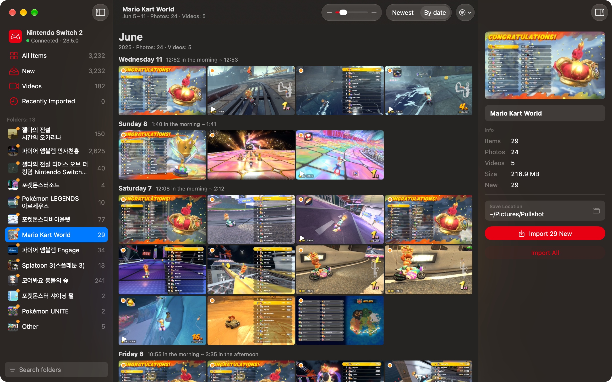
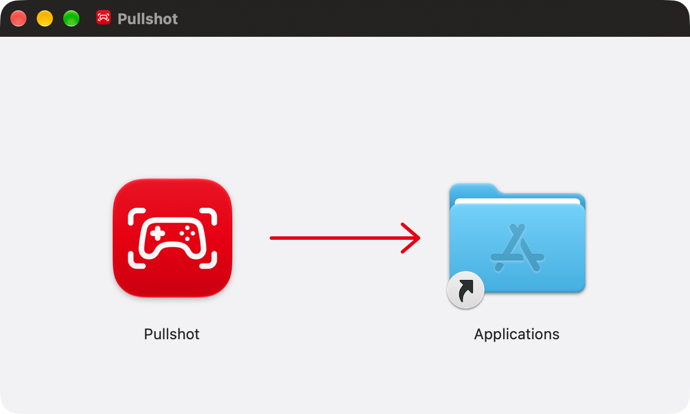

# Pullshot

English | [한국어](README.ko.md)

Pullshot is a Mac app that imports photos and videos taken on Nintendo Switch 2 and Nintendo Switch over a USB cable. It groups them by game, lets you import only the ones you select, and lets you drag them to Finder to save them straight into any folder. Nintendo Switch support is experimental.



## Requirements

- macOS 15 or later
- A USB-C cable that supports data transfer

## Install

Download the DMG from the [latest release](https://github.com/ParkGiraffe/Pullshot/releases/latest), open it, and drag Pullshot to the Applications folder.



The app is ad-hoc signed and not notarized by Apple, so macOS blocks it the first time you open it.

1. In the "Pullshot.app" Not Opened dialog, click Done. Move to Trash moves the app to the Trash.
2. Open System Settings > Privacy & Security, scroll down to Security, and click Open Anyway next to the message that Pullshot.app was blocked.
3. In the dialog that asks whether to open Pullshot.app, click Open Anyway.

You can also build it from source. Running `make dmg` also creates `dist/Pullshot-<version>.dmg`.

```bash
make app                 # Builds dist/Pullshot.app as a universal app for Apple silicon and Intel, ad-hoc signed
open dist/Pullshot.app
```

## Connecting

1. Connect the cable to the USB-C port on the bottom of the console, not the dock.
2. On the console, turn on Copy to PC in System Settings > Data Management.

## App

When you connect the Switch and turn on Copy to PC, the app connects automatically and reads the album. You can browse photos and videos by game and import new or selected items to the save location (`~/Pictures/Pullshot` by default).

The app is available in English and Korean. It follows the system language by default, and you can choose a language in Settings.

Logs are saved to `~/Library/Logs/Pullshot/pullshot.log`. Choose Help > Show Log File to select the log file in Finder. Logs don't include file names, game names, paths, or serial numbers. If something goes wrong, turn on "Detailed logging" in Settings, try again, and open a GitHub issue with the log file attached.

Choose Pullshot > Check for Updates… to check GitHub for a new version. Turn on "Check for updates automatically" in Settings to check every time the app opens. It's off by default. The update check is the only thing the app uses the internet for.

## CLI

Commands for development and debugging. Run them with `swift run pullshot <command>`. The CLI prints messages in Korean.

- `probe`: Prints device info, supported PTP operations, and storage.
- `list [--new]`: Lists photos and videos by game. New items are marked "새 항목" (new item) at the end of the line.
- `pull (--all | --new | <file name>...) [--out <folder>] [--numbered] [--no-game-folder] [--dry-run]`: Saves the given photos and videos with their original names in game folders inside the `--out` folder (`~/Pictures/Pullshot` by default). It doesn't follow the app's save location setting. With `--numbered`, files are numbered in the order they were taken, like `001_20261114_211205.jpg`.
- `ledger (--from-folder <folder> | --mark-all | --leave-new)`: Answers the first-connection question. Adds the photos and videos found in a folder, or all photos and videos on the Switch, to the import history, or keeps them all as new items.
- `dump --out <folder>`: Saves raw responses from the device. Don't share the saved folder, because it contains photo data and the device serial number.

Importing saves an import history to `~/Library/Application Support/Pullshot/`. New items are photos and videos that aren't in this history.

## Development

The development environment, coding conventions, how to open issues and pull requests, and how to make a release are in [CONTRIBUTING.md](CONTRIBUTING.md).

## License

Released under the MIT License. See [LICENSE](LICENSE) for the full text.

Pullshot is a personal open-source project and is not made or endorsed by Nintendo. Nintendo Switch and Nintendo Switch 2 are trademarks of Nintendo and are used here only to name the supported devices.

## Acknowledgments

- [Tethersnap](https://github.com/Luminoid/Tethersnap): Referenced for the 10 baseline PTP operations the Switch responds to (PTP is the USB protocol cameras and computers use to exchange photos), the Switch's USB product IDs, and the steps for cleaning up a session left open by a previous connection.
